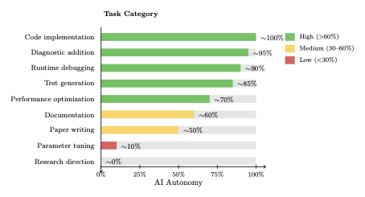

# Anjor Kanekar

{ align=right width="260" }

I'm a computational physicist turned Forward Deployed Engineer. I spent 7 years at Palantir building and hiring FDE teams, and I write here about how that role actually works — and about doing real physics research again, this time with AI.

---

## About Me

PhD in Computational Physics from the University of Maryland. I spent 7 years at Palantir as a Forward Deployed Engineer and hiring manager, conducted over 1,000 technical interviews, and trained hundreds of interviewers. Featured in [The Pragmatic Engineer](https://newsletter.pragmaticengineer.com/p/forward-deployed-engineers) on how FDE organizations work.

I run [Platypus Technologies](https://platypustech.xyz), where I advise companies on how to run forward deployed engineering, and train their FDEs. The framework behind that work, the [Platypus FDE Blueprint](https://platypustech.xyz/blueprint/), is published free.

I've also gone back to plasma physics research, handing more of the work to AI each time. I rebuilt my PhD-era code with Claude. The [code](https://github.com/anjor/gandalf) and [a paper describing it](https://github.com/anjor/gandalf-paper) are on GitHub. One study looked like a result until a closer check showed it was already known, so I closed it. My current study leaves the method to the model. More on the [research page](research/index.md).

---

## Writing

### Forward Deployed Engineering
The role is having a moment, and most of what's written about it is muddled. My running attempt to pin it down lives on the [FDE page](fde/index.md). It covers whether you need the role, what it is, the fork AI has opened up, and how to grow and train FDEs.

- **[How Do You Grow FDEs?](./writing/posts/grow-fdes.md)**: Most FDEs have to be grown. Define the role first, then the training.
- **[The Fast Layer and the Slow Layer](./writing/posts/fast-and-slow-layers.md)**: The tools change every few months. The craft of making a deployment work barely changes.
- **[If LEGO Had Forward Deployed Engineers](./writing/posts/lego-fde.md)** — What actually makes an FDE different from a really good consultant
- **[The FDE Fork: Platform or Outcomes](./writing/posts/fde-fork.md)** — The strategic choice founders don't realise they're making
- **[Is FDE a Bubble?](./writing/posts/fde-bubble.md)** — The title is spreading faster than the reasoning behind it
- **[The FDE Manifesto](./writing/posts/fde-manifesto.md)** — What the role is for, and why most companies get it wrong

### AI + Physics Research

{ width="700" }

- **[The Boundaries of Delegation](./writing/posts/boundaries-of-delegation.md)**: What I hand over to AI in research, one year on
- **[A Week in Vienna](./writing/posts/a-week-in-vienna.md)** — What I learned returning to a plasma-physics working meeting after twelve years
- **[The Autonomy Gradient](./writing/posts/autonomy-gradient.md)** — What AI can and can't do in physics research
- **[Writing a Physics Paper with Claude](./writing/posts/writing-gandalf-paper.md)** — Workflow, iterations, and hallucinations caught in review

### Hiring & Organizations
- **[The Unreasonable Effectiveness of Hiring Assholes](./writing/posts/hiring-assholes.md)** — Why conviction and ego are separate traits
- **[Context Matters: Hiring is Not Fungible](./writing/posts/context-matters.md)** — Why generic hiring processes fail
- **[Comand AI: A Hiring Case Study](./writing/posts/comand-ai.md)** — How we designed hiring for mission-driven engineers

[All writing →](writing/index.md)

---

## Work With Me

- **Get new FDEs ready to lead deployments** → [The FDE Programme](https://platypustech.xyz/engagements/#the-fde-programme). A two-day exercise on a realistic client case, then six weeks of coaching on their own deployments from people who have done the job. Each FDE gets a written verdict on whether they're ready.
- **Set up or fix an FDE function** → [Platypus Technologies](https://platypustech.xyz). Start with the [two-week assessment](https://platypustech.xyz/engagements/#fde-readiness-assessment): a written readout of where you sit against the Blueprint, what is wrong with the plan, and what to change in the next ninety days.
- **Speak to your team or portfolio** → the [talks page](talks/index.md). Panels, roundtables, and sessions for leadership teams and investors.
