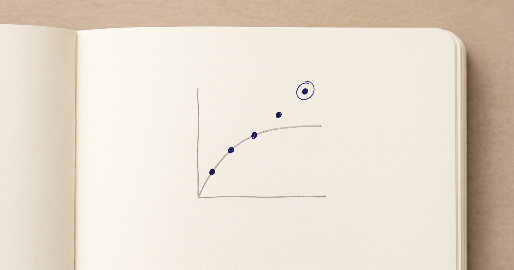
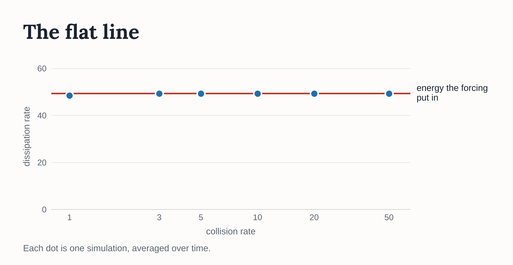
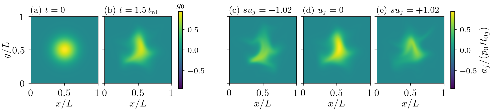
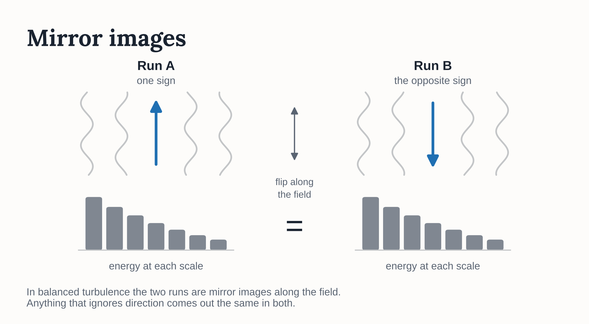
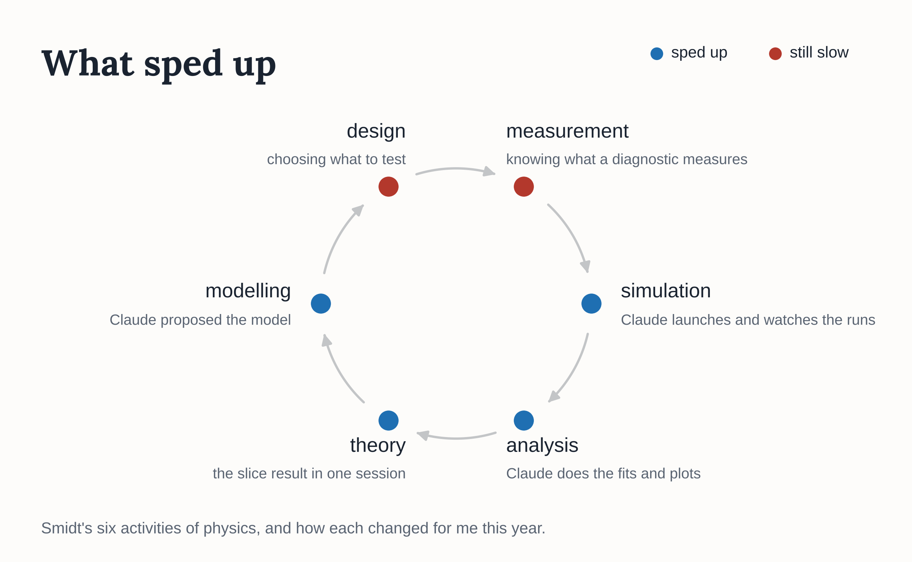

# Authority to surprise us

Tess Smidt at MIT has written an essay for Dædalus called [Physics Is Different: Context, Culture & Craft in Effective AI for Physics](https://www.amacad.org/publication/daedalus/physics-different-context-culture-craft-in-effective-ai-physics). She argues that AI will not solve physics. It helps when it fits into the cycle physicists already run: design, measurement, simulation, analysis, theory and modelling. It also has to respect the habits that make results trustworthy, such as approximation, verification and debate. The title of this post is her phrase. Her test for any tool, AI included, is whether it can tell us something we did not expect.

All year I have written about how much of my physics research to hand to Claude, most recently in [The Boundaries of Delegation](./boundaries-of-delegation.md). Smidt's test asks something else, which is whether the work that comes back can tell me anything new. Looked at that way, most of what Claude produced this year was confirmation. Confirmation has become very cheap. The results I now trust came from tests that could have failed. The one I trusted wrongly came from a test that could not.

## The plateau

A year ago Claude rebuilt GANDALF, the plasma turbulence code from my PhD. I trusted it by checking it against results we already knew, an approach I called [physics-oracle validation](./physics-oracle-validation.md). That is the right test for an instrument. It only works when you already know the answer.

In the spring we pointed GANDALF at an open question. In ordinary fluid turbulence, the rate at which energy is dissipated stays finite even as viscosity goes to zero. This is called the dissipative anomaly. I wanted to know whether the same holds for collisions in a plasma as they become very rare. The simulations gave a flat line. Across a 50-fold range of collision rates, the dissipation barely moved. I wrote it up as [a real physics result](./ai-undergrad-researcher.md).

In October, while working on something else, Claude measured how turbulent those simulations had been. They were barely turbulent. The plasma was behaving almost linearly, and the flat line came from how we drove it. We injected energy at a fixed rate. In a steady state, whatever goes in has to come out, whatever the collision rate. So the plateau was energy bookkeeping. The result was already in the literature, including a 2015 paper of mine. I closed the study and did not submit the paper.

This is the failure Smidt warns about. The simulations confirmed what we expected, and the set-up left them no other option. In May I had advised picking problems whose answer you can check at a glance. A glance told me the line was flat. It could not tell me that the way we drove the plasma had made it flat.

## The slices paper

The same October session produced the most interesting result of the year. Claude showed that the compressive part of the plasma behaves exactly like a set of dyes, one for each speed along the magnetic field. The turbulence stirs every dye in the same way, and each one also slides along the field at its own speed. So the turbulence never moves energy from one dye to another.

*A blob released into turbulence in GANDALF, at the start (a) and a little later (b). Panels (c) to (e) are three of its slices at the later time. All three start the same, and each one slides along the field at its own speed.*

Claude thought there was a paper in it, and a second loop drafted one within a day. The draft was competent and probably publishable, but I did not find it interesting. I asked for a rework built around a claim that the simulations could get wrong.

Claude proposed one. It is a simple model of how fine structure builds up in the plasma's velocities, and of how the turbulence erases it. Every input is measured in the simulation itself, so nothing can be tuned to make it fit. We wrote down its predictions before the main runs.

Some of it held. Under the conditions we started with, the model matched the simulations closely. Under other conditions it missed, and the miss showed that the turbulence erases old structure faster than new. The model also assumes that the erasing rate settles down once the simulation is fine enough. It did not settle. Each time we doubled the resolution, it changed by about the same amount. So in our runs the model's key timescale still depends on the resolution, and the abstract now says so.

The measurements surprised us too. On the fixed simulation grid, energy seemed to flow backwards, from fine velocity structure to coarse. Measured along the magnetic field lines, that backward flow disappears. Our spectrum also differs from the one in [a 2019 paper I co-authored](https://doi.org/10.1073/pnas.1813913116). We do not yet know why.

These are the results I trust, because each could have come out the other way. On 10 November I asked for one more set of runs. The paper claims a scaling with two parameters, and one of them had never been varied. My note at the time said "I want to be honest".

## Choosing the next experiment

Smidt looks ahead to AI that can suggest which experiment would teach us most. She also explains why AI-run experiments always seem a few years away. Labs and instruments would have to be rebuilt around them, which is slow and expensive. Simulation removes most of that obstacle. My lab is a GPU, a config file and a budget, so I could try her idea early.

In September I wrote a research memo with Claude on what to work on next. It ranked candidate projects and named the first result that would decide each one. It also said how to judge the AI's part. A system that proposes an early test that could kill a hypothesis beats one that runs many experiments inside a wrong frame.

The top project built on a new conserved quantity, found this summer by [Chandran, Mallet and Meyrand](https://arxiv.org/abs/2607.27981). It asked whether that quantity changes how turbulence moves energy into fine velocity structure. Study 04 put it into an autonomous loop. The loop could launch its own simulations within a GPU budget. Each stage needed a coded check and a review by an independent AI critic.

Two things went wrong before any real run. The loop spent its first ten days getting the critic to accept its own checking code. Then, in October, Claude examined the experiment the memo had ranked most decisive. It compared pairs of runs that inject the new quantity with opposite signs. In balanced turbulence those two runs are mirror images. Nothing the loop planned to measure could tell them apart. The memo had also taken the Study 02 simulations as its trusted starting point.

What worked was closer to what Smidt calls a reasoning partner. She hopes for AI that can tell when a model's assumptions have broken down. It would also suggest new ideas to test, as well as new data to collect. The October session caught the weak turbulence and the blind experiment. In the slices paper, Claude proposed the hypothesis and designed the runs to test it, with a cost for each. I chose which ones to run.

## Looking back

Smidt's six activities make a fair map of how my year changed. Running and analysing simulations now takes almost none of my time. Theory and modelling sped up too. The slice result came out of a single session, and Claude proposed the model the paper tests. Design and measurement did not speed up. Deciding what to test, and knowing what a measurement really measures, took as long as ever. The costliest mistakes of the year sat there. They were the way we drove Study 02, the turbulence nobody measured and the experiment that symmetry made blind.

Smaller problems matched her other warnings. A setting carried silently from one run into the next switched off the physics we wanted, until I asked where it had gone. The scripts behind the October findings were never saved. GANDALF itself has had thirteen releases since last November.

The pattern I least expected was my own work coming back. The slice picture has a precursor in a 2014 poster of mine. Part of the slices paper's hypothesis turned up in my thesis. The Study 02 plateau was in my 2015 paper. The new spectrum differs from the one in the 2019 paper I co-authored. Knowing that literature is what let me direct the work at all. It did not stop me presenting my own 2015 result as new in May.

## What's next

Study 04 needs a new experiment, one that could actually show an effect. Others are already working on its question. The lesson I most want to keep is to measure what regime the simulations are in before reading any result. The slices paper's new runs finish this week. Whatever they show will go in the paper.
