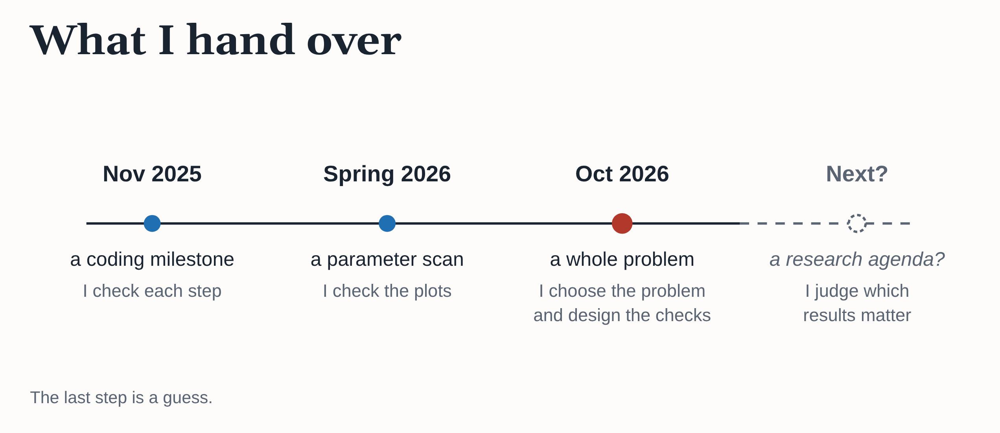
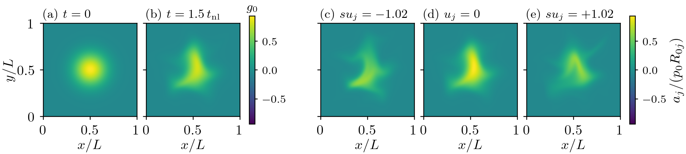
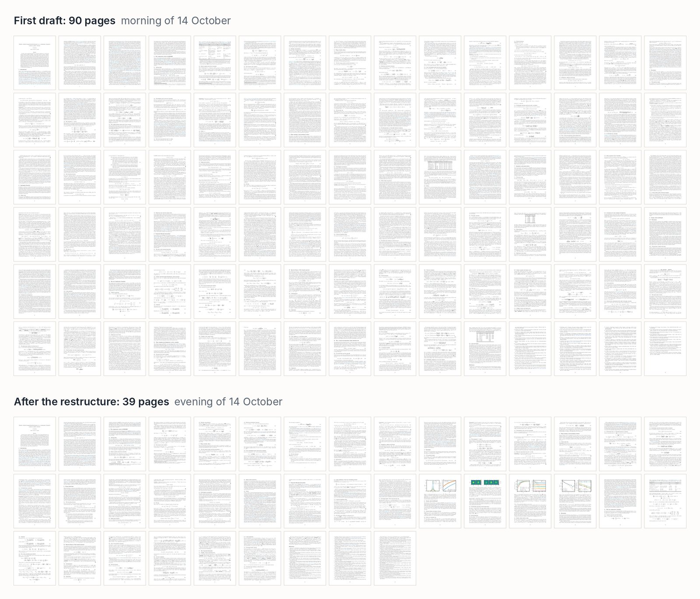
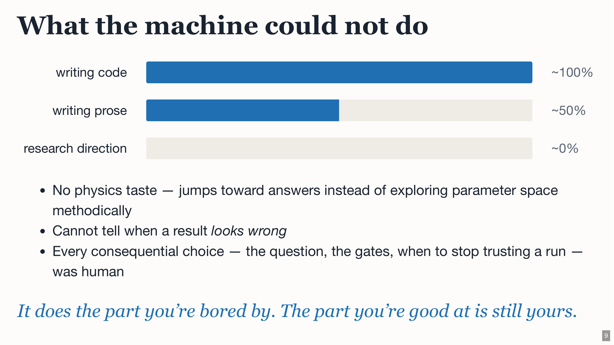
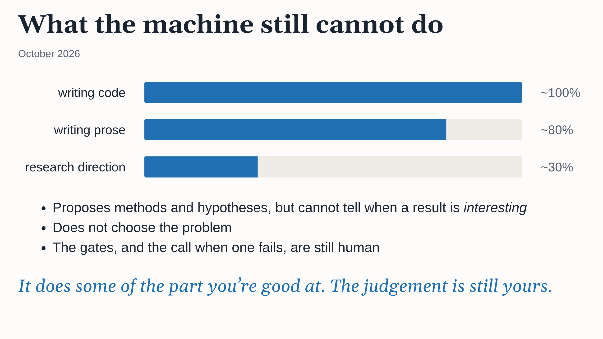

# The Boundaries of Delegation: The Autonomy Gradient, One Year On

In November last year I started an [experiment](./physics-researcher-ai-intro.md) to see whether AI could turn one physicist into a research team. I have written about it as I went, from [building GANDALF](./building-gandalf.md) to the [autonomy gradient](./autonomy-gradient.md) to [a first physics result](./ai-undergrad-researcher.md). Looking back over the year, the biggest change is in how much of the research I hand over, and in what I keep for myself.

The work I delegate has grown in three steps: first a coding milestone, then a parameter scan, and now a whole physics problem. Each step moved the boundary of what I do myself.



## A year ago: one milestone at a time

When I started, coding agents had just become good enough to write serious code. I asked Claude to rebuild GANDALF, my PhD-era gyrokinetics code, in JAX. It drafted a plan with milestones, and we worked through them one at a time. I didn't read the code. I checked the physics it produced instead, an approach I later wrote up as [physics-oracle validation](./physics-oracle-validation.md).

At the end of that project I tried to summarise what the AI could and couldn't do as an [autonomy gradient](./autonomy-gradient.md). Code implementation sat at about 100% and research direction at about 0%. My summary was that "AI can implement what is specified but cannot determine what to specify." I described the model as a capable undergraduate, and I argued that problem selection, validation and physics taste could not be delegated.

## This spring: a parameter scan

By the spring the code was in place, and the brief changed. I would describe a physics goal in a sentence or two. Claude would propose a config, run it on cloud GPUs, analyse the output and show me plots. On most days my side of the conversation was a handful of short messages, often just "go for it". The result was a [small paper on the dissipative anomaly](./ai-undergrad-researcher.md). Across a 50× scan in collisionality, the phase-space dissipation rate stays flat to under 1%.

The interventions that mattered were the kind an advisor makes: a missing coupling constant, three weeks spent inside the wrong hypothesis, and a figure that should have been dropped. My conclusion at the time was that the real constraint had become the speed at which I could validate what the AI produced.

## Vienna: analytic calculations

In August I went back to the Plasma Kinetics Working Meeting in Vienna for the first time in twelve years, which I wrote about in [A week in Vienna](./a-week-in-vienna.md). I arrived thinking of AI as a tool for the computational side of physics. I had not considered using it for analytic calculations, and some of the people there were doing exactly that.

One example has stuck with me. It happened in the first week, which I missed, so this is second-hand. A speaker presented a new invariant for one of the sets of equations that many of us work with. In various limits it reduces to invariants that were already known, but nobody had found the general form before. The derivation had been done without any AI.

Two attendees wanted to see whether a model could find it. One used Claude and the other used ChatGPT. The paper was already on arXiv, so they turned web search off. They started by giving the model the known limiting invariants and telling it that the general one was unknown. After a fair amount of back and forth, the model got there following a deliberately ungrammatical prompt:

```
do a breakthrough
```

I don't want to read too much into one example. The model was told what kind of answer to look for, which is a big hint. On the other hand, the result was only days old, and the model could not look it up. My guess is that a prompt like that pushes the model towards the tails of what it can produce. Whatever the explanation, it changed how I thought about what these models are for.

## Now: a whole problem

The brief has changed again. For my current study I describe the physics problem and leave the method to the model. If it needs code, it writes code.

The study is Study 04 in my [research repo](https://github.com/anjor/krmhd-research). It builds on a [recent paper](https://arxiv.org/abs/2607.27981) by Chandran, Mallet and Meyrand on the gyrokinetic helicity. The study asks whether conserving that quantity changes how free energy cascades to fine scales in velocity space. It runs as a loop: a series of Claude Opus sessions, each starting fresh, with the repository as the only memory. The brief for the loop includes this paragraph:

```
Nobody reviews the loop in real time. Three failures matter most: money
spent without anyone noticing, a gate passed on a hopeful reading, and
work lost between sessions.
```

Most of the design follows from those three. Every gate needs a coded check and a review by an independent AI critic. A launcher caps the GPU budget at 200 A100-hours. The loop stops and waits for me only for a short list of reasons, such as reaching the budget or wanting to change a pre-registered hypothesis. My side of the conversation now happens in a file. The loop writes a question with its options and a recommendation, and I reply with a line starting `ANSWER:`.

I expected the hard part to be the physics. In fact, the loop used no GPU time at all in its first ten days. It spent them getting the critic to accept that its own gate checks were sound, while I decided how strict those checks needed to be.

Here is one of those exchanges, shortened. "Part (a)" is one piece of the gate-checking code, and F1 to F4 were the critic's latest findings.

```
Q10. Gate 1 report machinery: the fourth review was refuted inside
your threat model. How should part (a) go on?

[...] Part (a) has now been refuted seven times in total [...]. Each
refutation found fewer and narrower faults, but there is no sign yet
of a review that comes back clean.

Options:
- (a) The loop fixes F1 to F4 with tests and asks the critic again [...]
- (b) The loop fixes F1 to F4 with tests, and you accept part (a) [...]
- (c) Simplify. [...]
- (d) Something else you choose.

Recommendation: (a). [...]

ANSWER: (c), simplify. Strip the gate report code down to what it
must do [...]
```

By then the critic had rejected this part of the gate code seven times. The loop recommended another round of fixes, and I chose to simplify instead.

The most interesting output so far is a side result. On 12 October I asked Claude to compare an appendix of that paper with GANDALF's equations. It found that the compressive fluctuations in KRMHD are exactly a continuum of passive scalars, one for each parallel phase velocity, and suggested there was an analytic paper in it.



*A figure from the side paper. A blob is released into decaying turbulence in GANDALF. Panels (a) and (b) show the lowest Hermite moment at the start and after 1.5 eddy times. Panels (c) to (e) show three of its phase-velocity slices at the later time. All three start identical, and each is carried by its own flow.*

I decided to let a second loop write that paper, starting on the afternoon of 13 October. By the next morning the draft was 90 pages long, which was far more than the result needed. I asked for it to be restructured around a single message, and by that evening it was down to 39 pages. By then, scripts checked every number, and it had been through two rounds of AI referee reports.



*The side paper before and after I asked for the restructure.*

I read it the following morning. It was a competent paper and probably publishable, but I didn't find it interesting. My reply (P1 is the paper) was:

```
I am not going to publish the current P1. So this is reworking it.
```

For the rework, the loop proposed a sharper hypothesis and simulations to test it. Its literature check found part of that hypothesis in my own 2015 thesis, which I had not expected to have cited back at me. The first production run took 15 hours on a spare MacBook. It then failed one of the validation gates by a small margin: 1.11% of the free energy sat above Hermite moment 24, against a limit of 1%. The loop stopped and asked me what to do, as the rules require. I chose how to proceed, and it carried on.

A practical note on the models. Opus 5.5 at maximum effort is the most capable model I have worked with, and it is noticeably more independent than what I used last year. It also catches more of its own mistakes. The cost is usage. I now run through my Max plan's limit within about an hour of it resetting. A few of the loop's "failed" sessions were me pressing Ctrl-C, because I needed the usage for something else.

## Where the boundary sits now

This is the slide on autonomy that I showed in Vienna in August.



Parts of it already look out of date. This is how I would draw it now.



What is left for me is choosing the problem, designing the checks and deciding whether a result is interesting. The model now does a fair amount of what I would have called research direction a year ago. It found the structure in the appendix, suggested it was worth a paper, and proposed the hypothesis for the rework. Where it still falls short is judgement about what matters. It thought the analytic result made a strong paper, and I disagreed.

The hard part is deciding how much to hand over. If I hold on too tightly, I lose most of the benefit. If I let go completely, I stop thinking about the physics myself, and that is how you end up with slop. I don't think there is a stable answer, and I expect this slide to look dated in six months as well.

## The wider context

It is hard to write about this without mentioning mathematics, where the same shift is happening at a much larger scale. On 8 September, OpenAI announced that an internal system had produced a proof of finite-time blow-up for the 3D Navier–Stokes equations with a smooth external force. The proof is formalised in Lean. The Clay Institute has not accepted it, and [the credit is disputed](https://en.wikipedia.org/wiki/Navier%E2%80%93Stokes_priority_controversy). On 6 October, OpenAI published full or partial solutions to [more than 370 open problems](https://openai.com/index/sharing-ai-progress-in-mathematics/), and withdrew at least three of them within days. Reactions have been [mixed](https://fortune.com/2026/10/07/openai-math-controversy-solutions-370-outstanding-challenges-published-criticisms-celebration/). Terence Tao described the release as the end of "Math 1.0", while Dan Litt called it "great for mathematics".

Physics is not far behind. In a new benchmark called [TheoPhysEval](https://arxiv.org/abs/2610.16733), the best agent solved 98% of 50 unpublished research-level problems in theoretical physics, at under $3 a problem. The authors also found that accuracy barely changed without web search, which they read as memorisation, and they discuss why agents have not yet produced breakthroughs. Closer to home, Matt Landreman has just posted [exact solutions](https://arxiv.org/abs/2609.26742) for 3D MHD equilibria with nested flux surfaces, which he presents as counterexamples to Grad's conjecture. His acknowledgements say the solutions were found with GPT-6 Astra Pro, and that he confirmed every equation by hand.

## Checking the work

One difference between mathematics and physics matters a lot here. Mathematicians can check many AI-generated proofs in Lean, which is part of why the field can absorb results at this scale. Physics has nothing equivalent in everyday use. Our derivations rely on orderings and approximations, and a proof checker can't yet tell you whether those are physically sound. [Lanyon](https://lanyon.ai), a new startup, is trying to change that. It is building formally verified software for physics, where code comes with machine-checkable proofs that it does what its specification says. I hope it works.

Until then, our checks are the ones physicists have always used: codes, conservation laws, known limits and derivations by hand. They run in both directions. Landreman offers his exact solutions as test cases for equilibrium codes. My side paper tests its analytic results against GANDALF. The Vienna experiment tested the models themselves, by asking them to rederive a result they could not have seen. Physics-oracle validation was how I learnt to trust code I hadn't read. The same idea now has to stretch to cover analytic work as well.

## Beyond physics

I think the question of where to draw this boundary applies well beyond physics. A lot of companies are trying to become "AI native", or "AI-pilled", whatever that means. In practice, that comes down to the decision I have been making all year: which parts of the work to hand over, and which to keep.

Getting it right needs two things that pull in different directions. The first is ambition. I have underestimated these models at every step this year. Each time I handed over a bigger piece of work, the model coped with more of it than I expected. So people have to be ambitious and creative about what might now be possible, and then try it. The second is restraint: handing over the work without handing over the thinking. At least for now, someone still has to decide what matters and check what comes back.

It is also hard to know in advance where the boundary is, because this intelligence is jagged. The model that found an exact result in KRMHD in a day could not tell that the paper it wrote was uninteresting. Last year, the model that implemented a spectral code could not tune a simulation to give a textbook spectrum. Strengths and weaknesses sit side by side, and the pattern differs from one kind of work to another. So there is no general rule. Each company has to find the boundary for its own work, by trying things and checking the results. It then has to find it again each time the models improve.

## What's next

The simulations for the reworked paper are running now, and Study 04 still has to get past its first gate. I don't know yet whether either will turn up something interesting. I should know in a few weeks.

---

### Acknowledgements

Thanks to Alex Schekochihin and the other organisers of the Vienna meeting for inviting me back. The Anthropic team for the tools.
