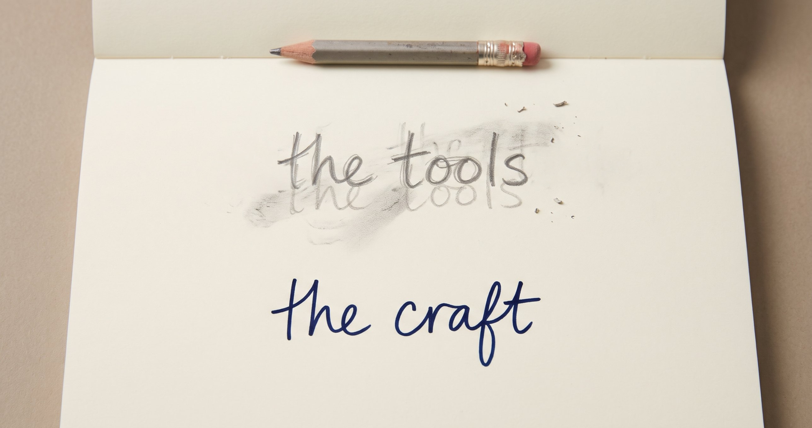
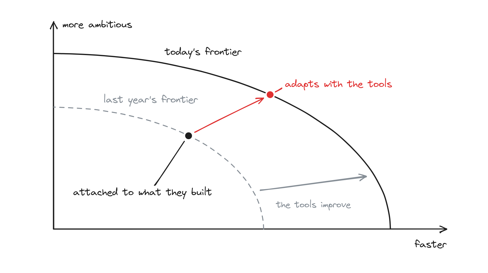

# The fast layer and the slow layer

The Palantir deployment I talk about most was with a team that did the final checks on planes before they went to airlines. Their data had to be less than an hour old, and it wasn't. I was the tech lead. I didn't know Elasticsearch or Foundry's export layer when I started. I learnt both quickly, because the outcome depended on them. I kept the users going with hacks. Then I worked with the product team on the real fix.

Two kinds of skill went into that. One was technical. The tools I learnt then have long since moved on. The other was knowing what to do. I had to work out what mattered to those users. I had to decide what to hack, what to fix properly and when to bring in the product team. That part hasn't changed.

I think of what makes a good FDE in the same two layers. The fast layer is technical skill. Its demands change quickly, and with AI they now change every few months. The slow layer is how to impl, Palantir style. Impl was our word for the craft of making a deployment work. I learnt its truths first-hand. They have barely changed since my first deployment. They are also what separate elite FDEs from the rest.

## The fast layer

At Palantir, the fast layer was Foundry and the systems underneath it. In [the FDE manifesto](./fde-manifesto.md), I wrote up the habits of Stokes, a legendary Palantir FDE. One was to own the product stack: clone the repos, make them build and know the architecture cold. Today the stack also includes models, agent harnesses, evals and the glue code between them.

You can't skip this layer. In [If LEGO had forward deployed engineers](./lego-fde.md), I argued that an FDE has to be technical enough to drill the brick. Otherwise the signal they bring back to product is mush.

The stack has always moved, but AI has made it move much faster. In my own physics work, I have [underestimated the models at every step](./boundaries-of-delegation.md) this year. Whatever anyone knows about the stack today will be partly stale within a year.

So what you know matters less than how you move with it. Strong FDEs aren't chased by the pace of change. They adapt and evolve with the changing shape of the technology. They also don't get too attached to what they've built. When something better arrives, they'll throw their own work away. That keeps them at the Pareto frontier of what's possible.

## The slow layer

Nobody taught me impl in a classroom. I never had any onboarding at Palantir. I learnt it on deployments, where I was given more responsibility than I was comfortable with. These are the truths I came away with.

**Aim at the mission.** Be able to say in one sentence what the whole organisation is for. A hospital treats patients. An insurer prices risk. Connect your work to that purpose, not just to the team you sit with. The problem you're handed is often the one that was easiest to fund. If it's far from the mission, or nobody in it makes real decisions, renegotiate early. You own the outcome, not the task, the way [two founders own a startup](./two-founders.md).

**Find the one who makes the call.** It's rarely the person who bought your software. It's the person who looks at the situation, makes the call and does the thing. Unless they change how they work, nothing changes. So sit with them while they do the job. Watch the workflow, not the words. What people say they do and what they actually do are different. Only one of them is the spec. Put something real in front of them early, and turn their feedback round the same day.

**Build around the decision.** At the centre is a model of the decision that matters most. It covers the people involved, the options they have and where the data comes from. Palantir called this the ontology. Build the screens on top of the model, not the other way round. Then different people can see the same world through different windows. Make sure each call lands back in the systems the organisation runs on. Otherwise you've built a viewer. Be wary of dashboards, too. People ask for them, and they rarely change a decision.

**Prove it in use.** Start from the job as it's done today, even when you can see a better one. The people doing it now will tell you fastest whether you're right. Record the real decisions that go through your work, and what changed because of them. That record beats any demo. The bar is that people would miss it if it went. When it's working, it starts bumping into the edges of the team you built it for. Each edge is the next piece of work.

**Bring the bricks back.** Keep users going with hacks when you have to, then fix the root cause with the product team. Every hack is a weird brick. The customer gets the outcome. Your company gets the bag of weird bricks.

**Do your own thinking.** None of this runs on autopilot. Building exactly what the brief says can get something shipped. It rarely changes how the place runs. Hand AI the work, but not the thinking. It can build what you specify. It can't tell you what to specify. And find people who will tell you bluntly when you're wrong. From inside a deployment, you can't see your own blind spots.

Here is how the difference shows up. Two engineers can have the same technical skills. One builds something impressive. The other changes how the organisation makes its decisions. In [my 2024 hiring post](./hiring-fdes.md), one of my unforgivables was someone who "goes after the shiny thing". AI has made that failure much cheaper. You can now build the wrong thing in an afternoon.

## What you can teach, and what you can't

Each layer has parts you select for and parts you can train.

On the fast layer, select for engineering depth and the ability to learn. The 2024 post asked for "someone who is not set in their ways, but has a high ability to learn and grow". Then train the stack itself. At Palantir, [learning the product was the easy part](./grow-fdes.md). Vendors now help with their own tools. This autumn, [Anthropic](https://www.anthropic.com/news/claude-frontier-academy) and [AWS](https://aws.amazon.com/blogs/apn/new-fde-pathways-for-aws-partners-get-ready-for-production-agentic-ai-delivery/) both launched FDE programmes, and each teaches its own stack. But this training never finishes, because the layer keeps moving.

On the slow layer, select for the traits. The four essentials from that 2024 post still hold: outcome oriented, critical thinker, high chaos ceiling and gritty. A few weeks of training won't give anyone grit.

The craft can be trained, but not from slides. At Palantir it came from real deployments, from mentors and from the trust you were given. In the programmes I've designed since, feedback has done more than teaching.

The clearest case was at a large IT services firm. Its first cohort of FDEs worked through a simulated engagement, with coaches and leaders playing the client. They worked in two pods, each mixing domain experts and engineers. Each pod had a case drawn from a problem the firm had already solved. Every day had two checkpoints. At noon, coaches sat with each pod for fifteen minutes and tested its direction. In the evening, a panel scored the work.

A few days before, I had given the cohort a masterclass. It told them to start from the data models and tools the firm already had. On the first morning, both pods started by building their own data model anyway. At the noon check-in, the coaches turned both pods towards what the client would actually see. Both had working software by the evening. By the next morning, both were working back from the client's outcome. My masterclass hadn't landed. Fifteen minutes at their own table did.

## Design it from first principles

How you train depends on the company. Its culture, ethos and strategy all shape what works.

Palantir threw people in at the deep end. That only worked because of what surrounded it. New engineers had mentors, and every deployment paired an FDE with a strategist. A product team took the weird bricks, and one hiring manager held the bar. The ethos gave people autonomy and trust. Most companies don't have that system, so they can't simply copy the deep end.

Strategy changes what you train. In [The FDE fork](./fde-fork.md), I argued that the role follows from strategy. On the platform path, the FDE is a product scout, so feeding the product team comes first. On the outcomes path, the FDE is the product, and the weird bricks go to your own internal tooling. The truths stay the same, but the habits you build are different. And a firm that bills clients for FDE hours works against the whole motion, whatever its training says.

Culture matters just as much. At one company I advised, [some of my Palantir assumptions](./we-need-fdes.md) didn't fit the people and culture there. We narrowed the effort and adjusted as we learnt.

So no generic FDE programme fits every company. You have to design yours from first principles. Start with what you are trying to achieve. Then decide which parts of each layer to select for, and which to train, given who you are.

## The thread

I ended [Is FDE a bubble?](./fde-bubble.md) with "FDE is not the path to success. Solving problems from first principles is." That post argued that Palantir's FDE role was the residue of solving one problem from first principles. Copying the residue without the reasoning doesn't work. The same is true of training.

Looking back, that idea runs through most of what I've written this year. I've never spelled it out. Think from first principles. Work out what matters. Then reorient yourself to go after it.

When a new client says ["We need FDEs"](./we-need-fdes.md), I usually ask what they are trying to achieve. In The FDE fork, the role follows from your strategy, so you have to pick on purpose. When I wrote about growing FDEs, the point was to define the role for yourself, and then the training. In The Boundaries of Delegation, each company has to find its own boundary with AI. It then has to find it again each time the models improve.

It is also the heart of the slow layer. At Palantir, the broad title let each of us find where we could add the most value, and go do it. On a deployment, the best FDEs work out what matters before they build. They change course when they learn something new, including when the tools move. Designing an FDE programme is the same work, pointed at your own company.

The fast layer will keep changing. Work out what matters, and go after it.
