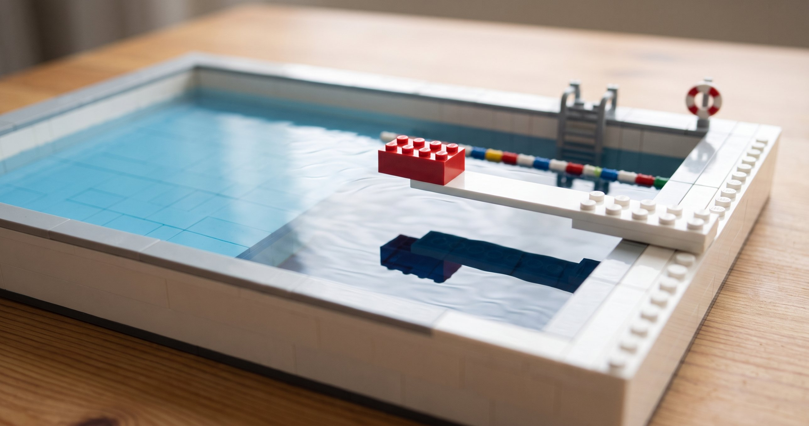

# How do you grow FDEs?

My friend Vinoo Ganesh led Palantir's Frontline programme. It sent new software engineers into the field for their first six months, before they joined a product team. More than 250 engineers went through it. In his [guide to forward deployed engineering](https://nextplayso.substack.com/p/the-definitive-guide-to-forward-deployed), he asks how you hire FDEs, with the answer "You don't. You grow them."

I mostly agree. Most companies will need to hire a few experienced people first, but the rest have to be grown. And right now a lot of companies are trying to grow them. Anthropic has committed [$100 million](https://www.anthropic.com/news/claude-frontier-academy) to train 10,000 FDEs, and Mistral is [hiring a head of FDE learning](https://jobs.generalcatalyst.com/companies/mistral-ai-2/jobs/94728369-head-of-fde-learning-programs). In the last two months I've worked on three versions of this myself.

## How Palantir did it

So how do you grow one? At Palantir, you were thrown in at the deep end. I never had any onboarding. Funnily enough, I was not actually hired as an FDE, but as a quality engineer. I had studied physics, never done an internship, and didn't know any Java. In my first week as a QE, I was brought in to help make a deployment more stable. I happened to be sitting next to an FDE who was debugging a pipeline written in Python, but he didn't know Python, so I offered to help. Next thing I know, I was in Zurich next to a data scientist, doing FDE things.

Being thrown in early was normal. Palantir hired far more new grads than people from industry. After a three-month first deployment, your second could mean tech leading one, in rooms with the C-suite of a Fortune 500 company. You were given more responsibility than you were comfortable with. That was the training. Whoever staffed you went in like a good scientist, with a hypothesis, and course corrected if it failed.

## Why the deep end worked

The deep end only worked because of what surrounded it. Vinoo writes that they learned quickly that throwing engineers into the field wasn't enough, so every Frontliner got a mentor. Every deployment paired an FDE with [a strategist](./two-founders.md). There was a product team to take the [weird bricks](./lego-fde.md) that FDEs brought back. And there was [one hiring manager](./palantir-hiring.md) holding the bar. Learning the product was the easy part. How to operate as an FDE came from the people who mentored you, the culture, and how much autonomy and trust you had.

Most companies trying to grow FDEs today don't have that system. A startup hiring its first FDEs has no strategist to pair them with, and often no product team ready for the weird bricks. Nobody has calibrated a hiring bar. So they can't simply copy the deep end. They need a version that fits them.

## Define the training, not just the role

This is the same point I made in ["We need FDEs" is not a complete sentence](./we-need-fdes.md). FDE is an ill-defined role. That's valuable because it makes for an adaptable org, but it means you have to define the role for yourself. The same goes for training. If the role is yours to define, so is the training. A generic course can teach the craft. It can't teach your role.

Here is what that looked like for the three companies I've worked with.

A large IT services firm wanted its people to work as FDEs, in pods of domain experts and engineers. The firm hand-picked the cohort, and the cases came from problems it had already solved. Each pod got a client rather than a specification. The operational users were hidden until someone asked the right question, and the client changed its mind every day. Coaches checked in at noon, and pods defended their work each evening. We scored people as a profile across four areas, not as a single total. There is a review 30 days into real work.

A marketplace of freelance developers wanted to place some of its people with AI platform companies. That called for something else. I sketched a remote programme in pairs, with one deployment simulation running throughout. Teaching would come in only when the scenario needed it. It would end with a call on each person: ready for a paired deployment, ready with conditions, or not ready yet. It was also designed so the marketplace could run later cohorts itself.

A startup I've worked with wanted to onboard engineers onto its own agent platform. My advice there was to keep it simple. Keep the product material. Add a project, run in the pods they'd use with a real client, from scoping through to a demo. They are also adding a murder board. That's a Palantir habit I really liked, where a new hire explains the architecture to someone very senior, who grills them. If the client's IT team asks a question on a call, you shouldn't have to say "I don't know".

## What every programme needs

The three look different, but they share a few things. Each starts by choosing people carefully, because a few weeks won't give anyone grit. Each looks like a deployment, with a client who is vague and keeps changing their mind. Each leans on feedback more than lectures. At the services firm, I had told the pods to reuse the data models they already had. On the first morning, both built their own anyway. A short check-in at noon turned them round faster than my masterclass had. And each programme ends in real work, with someone there to nudge people in the right direction.

None of it sticks if the system around people stays the same. I told the services firm's leaders this before we started. A programme can't decide how you assess and promote FDEs, how you shape the teams, or where the bar for reusable work sits. It can't decide how you sell the work either. If you bill clients for FDE hours, you're working against the whole motion.

Helping companies work through this is now a growing part of what I do at Platypus. I help them define what an FDE means for them, and then design the training to match.

"We need FDEs" isn't a complete sentence. Neither is "we need to train them".

*If you're designing an FDE programme, I'm happy to compare notes. The [Platypus engagements page](https://platypustech.xyz/engagements/) has more.*
