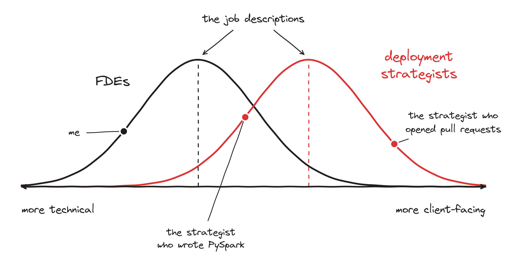

# Every deployment is a startup with two founders

When people hear how Palantir staffed its deployments, they usually picture a project manager and an engineer. The deployment strategist manages the client, and the forward deployed engineer builds the thing. Yes and no.

Palantir did hire for two roles. Palantir had funny names for everything, so strategists were Echoes and FDEs were Deltas. The technical bar for strategists was lower at hiring. They didn't need to be engineers, but they did need to be analytical. They had to take an open-ended question and answer it with data. Many of them also had domain expertise or were good at managing accounts.

But the mental model I always come back to is different. Think of each deployment as a self-contained startup with two founders. The strategist is the CEO and the FDE is the CTO. If you're running a startup with your co-founder, it doesn't really matter what your title is. Your title may be CEO, but you'll be writing code sometimes. Your title may be CTO, but you'll be on sales calls and doing ops. The titles shift the rough set of responsibilities. They don't draw a line between them.

On one of my deployments there were four of us. I was the tech lead, and there were two strategists and another engineer. One of the strategists, a good friend of mine, had a PhD in mechanical engineering. She wrote a lot of the PySpark code that integrated the client's data. She was also the face of the deployment to the client. The other strategist was not technical at all and could barely write Python. One part of our pipeline had to be in Java for performance reasons. When he needed something changed there and I wasn't helping, he would just open a pull request himself. His attitude was: fine, I'll do it my way and break everything, and then you'll have to help me. It worked. I'd end up saying "okay, fine, I'll fix it."

Funnily enough, I didn't do much of the client-facing work myself. The strategists I worked with did far more of it, and I mostly talked to my technical counterparts on the client side. Other FDEs I know did a lot more. Both roles are really distributions, and the job description is roughly the median.

The founder framing also came with a lot of autonomy, and that's how it actually ran. I did some crazy things. One customer was running out of disk space on an on-premise deployment, and their procurement was going to take nine months. So I bought hard disks on my corporate card, shipped them to the customer, and we figured out billing later. I didn't ask anyone for approval. It's what a CTO would have done.

The part people miss most often is that the pair is one unit. They own the business outcome together, so if one of them drops the ball, they both have. Their incentives are aligned with each other. That is what lets them deal with all the incentives that aren't aligned, like product wanting one thing and leadership wanting another. I wrote in [If LEGO had forward deployed engineers](./lego-fde.md) about why some of that misalignment is deliberate.

I saw this go wrong recently. A company I advise pairs its deployment leads and engineers many-to-many, to keep staffing flexible. When I tried to draw it, I ended up with one lead connected to three engineers, and one of those engineers connected to a few other leads. I couldn't reason about it. One of their leaders told me he'd started seeing Slack messages like "I discussed with him and he said he will get this done." Work was being thrown over the fence. My suggestion was to group their customers by use case or user type, and give each group a dedicated pair. One person working across a few pairs is fine. Many-to-many isn't. People aren't fungible.

Not every deployment needs to work like this. If there isn't much product discovery, and what you really need is someone to fill a gap on execution, a different shape can make sense. So the first question is what you are trying to achieve by putting people in the field. The second is whether you have the right shape of people for it.

If it's discovery, hire two founders.
